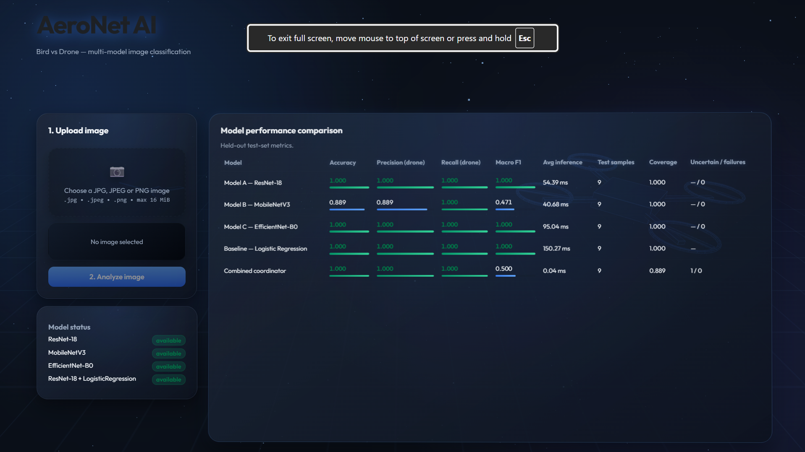
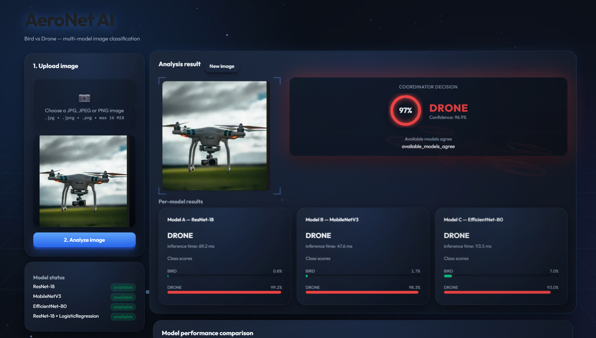
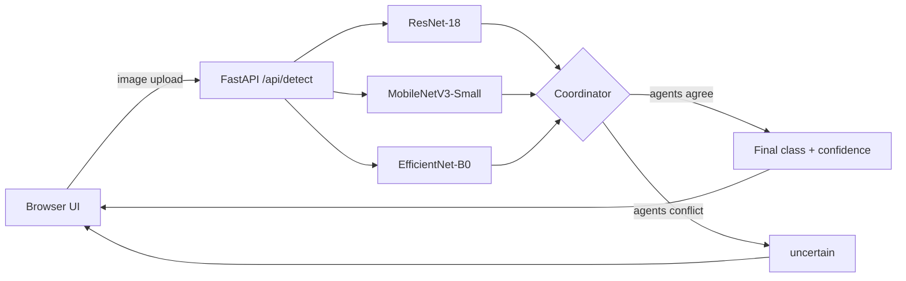

<div align="center">

# 🛰️ AeroNet AI

**Multi-model bird vs. drone image classification with a prediction coordinator and an interactive 3D dashboard.**


</div>

## Overview

AeroNet AI classifies an uploaded image as a **bird** or a **drone**. Instead of trusting a single network, it runs several independent deep learning agents and uses a **coordinator** to fuse their outputs. When the agents agree, the shared class is returned. When they conflict, the result is flagged as `uncertain` rather than forced into a guess.

The project covers the full workflow: dataset preparation, model training, evaluation, a REST API, and a browser dashboard for upload, results and model comparison.

## Screenshots

### Dashboard



### Classification Results



## Highlights

- **Multi-agent inference:** ResNet-18, MobileNetV3-Small and EfficientNet-B0 each predict independently.
- **Coordinator with disagreement handling:** unanimous agreement returns a class; conflicts return `uncertain`.
- **Per-model transparency:** each model's prediction, class scores and inference time are shown next to the final verdict.
- **Evaluation dashboard:** accuracy, drone precision and recall, macro F1, average inference time, test sample count, coverage and uncertain/failed counts, compared side by side.
- **Honest model handling:** no generic ImageNet classifier is substituted when a trained checkpoint is missing, and unavailable metrics stay unavailable.
- **CPU-friendly:** runs inference without a GPU.
- **Interactive 3D interface:** Three.js scene, animated confidence gauge and scan effects, built with plain HTML, CSS and JavaScript.
- **REST API:** detection, model status, evaluation, manifest and history endpoints.
- **Automated tests** for application behavior and model integration.

## Architecture



## Models

| Model               | Architecture                 | Role                                               |
| ------------------- | ---------------------------- | -------------------------------------------------- |
| ResNet-18           | Convolutional Neural Network | Active agent (trained checkpoint)                  |
| MobileNetV3-Small   | Lightweight CNN              | Active agent (trained checkpoint)                  |
| EfficientNet-B0     | Convolutional Neural Network | Active agent (requires trained checkpoint)         |
| Logistic Regression | Traditional ML baseline      | Evaluation reference only; not a coordinator agent |

Model implementations live in `models/`; checkpoints and evaluation output live in `artifacts/`.

## Tech Stack

| Layer             | Technology                         |
| ----------------- | ---------------------------------- |
| Backend           | Python, FastAPI, Uvicorn           |
| ML                | PyTorch, torchvision, scikit-learn |
| Frontend          | HTML, CSS, JavaScript, Three.js    |
| Testing           | pytest                             |
| Deployment config | Render (`render.yaml`)             |

## Project Structure

```text
aeronet_ai/
├── artifacts/       # Model checkpoints and evaluation artifacts
├── backups/         # Local backups
├── dataset/         # Classifier input images
├── evaluation/      # Evaluation-related files
├── models/          # Model agent implementations
├── results/         # Generated results
├── samples/         # Sample images
├── screenshots/     # Dashboard and result screenshots
├── scripts/         # Training and supporting scripts
├── services/        # Application services
├── templates/       # Browser-based frontend
├── tests/           # Automated tests
├── app.py           # FastAPI application
├── dataset_prep.py  # Dataset preparation utilities
├── predict.py       # Prediction utilities
├── train.py         # Training entry point
├── requirements.txt # Python dependencies
├── render.yaml      # Render deployment configuration
└── README.md
```

## Quick Start

**Requirements:** Python 3.10+ and pip.

```bash
# 1. Clone
git clone https://github.com/v-aibha-v/aeronet_ai.git
cd aeronet_ai

# 2. Create a virtual environment
python -m venv .venv
```

Activate it:

```powershell
# Windows (PowerShell)
.\.venv\Scripts\Activate.ps1
```

```bash
# macOS / Linux
source .venv/bin/activate
```

Install and run:

```bash
python -m pip install --upgrade pip
python -m pip install -r requirements.txt
python app.py
```

Open **http://127.0.0.1:8000/** in your browser.

## Training and Evaluation

Train EfficientNet-B0 only (may download pretrained torchvision weights on first run):

```bash
python scripts/train_models.py --efficientnet-only
```

Retrain all models:

```bash
python scripts/train_models.py
```

> Retraining can replace existing ResNet-18 and MobileNetV3 checkpoints. Back up any you want to keep first.

Evaluation results are written to `artifacts/evaluation.json` and shown in the dashboard's **Model performance comparison** table. They can also be regenerated through `POST /api/evaluate`.

## Dataset

The bundled demo dataset contains **5 bird** and **55 drone** images, enough to demonstrate the full training, evaluation and inference pipeline end to end. For production-grade accuracy, replace it with a larger, balanced and independently labeled dataset using the same `dataset/` layout. `artifacts/evaluation.json` always records the real test-set size, class distribution and metrics.

## API Reference

| Method | Endpoint            | Description                           |
| ------ | ------------------- | ------------------------------------- |
| GET    | `/`                 | Browser-based interface               |
| POST   | `/api/detect`       | Classify an uploaded image            |
| GET    | `/api/models`       | Check model availability              |
| GET    | `/api/evaluation`   | Retrieve evaluation results           |
| POST   | `/api/evaluate`     | Run the evaluation workflow           |
| GET    | `/api/manifest`     | Retrieve the dataset manifest         |
| GET    | `/api/stats`        | Retrieve prediction-history summaries |
| GET    | `/api/history.json` | Retrieve prediction history as JSON   |

### Example

`/api/detect` accepts an image in the multipart form field `image`.

```python
import requests

url = "http://127.0.0.1:8000/api/detect"

with open("samples/drone.png", "rb") as image_file:
    response = requests.post(
        url,
        files={"image": ("drone.png", image_file, "image/png")},
        timeout=60,
    )

response.raise_for_status()
print(response.json())
```

## Testing

```bash
python -m pytest -q
```
